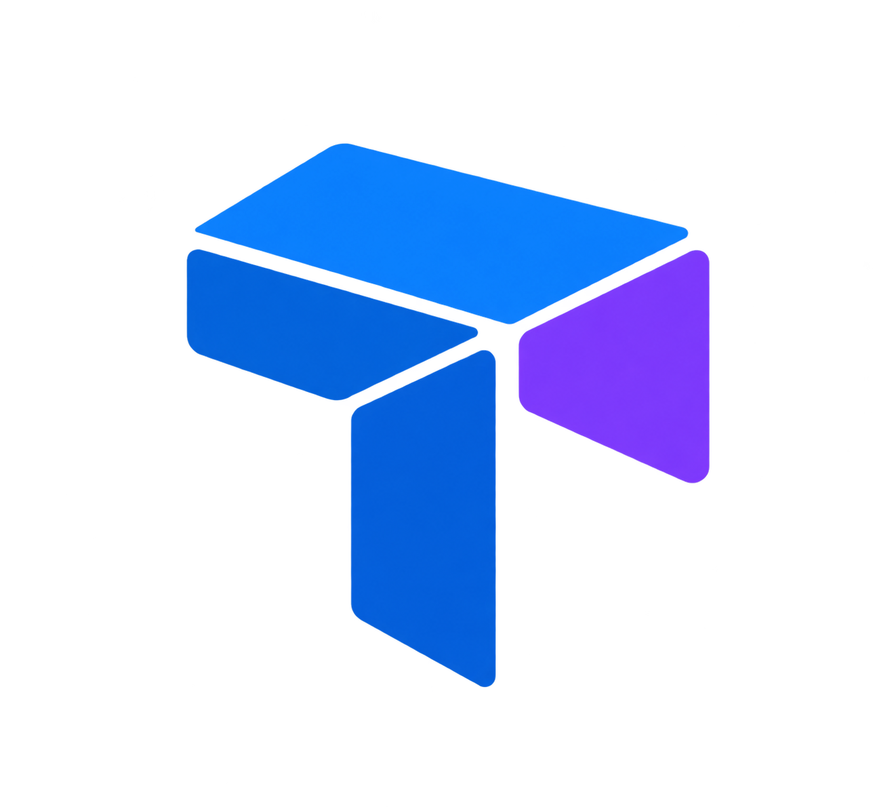

<p align="center">
  
</p>

<h1 align="center">TSNX</h1>

<p align="center">
  <strong>The Enterprise Web Application Framework and Modular Project System for TypeScript</strong>
</p>

<p align="center">
  <a href="https://www.npmjs.com/package/@tsnx/web"></a>
  <a href="https://github.com/tsnxjs/tsnx/blob/main/LICENSE"></a>
  <a href="https://nodejs.org"></a>
  
  
</p>

<p align="center">
  <a href="https://tsnx.vercel.app/docs/quick-start/"><strong>Explore Official Documentation & Quick Start &rarr;</strong></a>
</p>

---

## Overview

TSNX is a backend application framework and project orchestration system designed for building structured, maintainable, and high-throughput services on Node.js.

### Core Architectural Pillars

- **Modular Project System**: Native TypeScript Project References and package workspaces with DAG-driven incremental compilation, strict boundary enforcement, and bidirectional project reference wiring.
- **Enterprise Dependency Injection**: Structured lifetime semantics (`Singleton`, `Scoped`, `Transient`) with automatic request-scoped isolation, captive dependency prevention, circular reference diagnostics, and deterministic reverse-order disposal.
- **High-Performance Web API**: Layered onion middleware pipeline, hierarchical route grouping, declarative parameter binding with compile-time recursive type inference, and RFC 7807 Problem Details error handling.
- **Integrated API Documentation**: First-class OpenAPI 3.1 metadata extraction (`@tsnx/openapi`) and embedded, zero-configuration interactive reference documentation powered by Scalar (`@tsnx/scalar`).
- **Coordinated Lifecycle & Resilience**: Predictable graceful shutdown orchestration, asynchronous cooperative cancellation via standard `AbortSignal`, and request execution deadline enforcement.
- **Unified Developer Tooling**: Comprehensive command-line interface for project scaffolding, compilation, execution, testing, and continuous hot-reload development.

---

## Example

Building an enterprise HTTP service with Dependency Injection, OpenAPI 3.1 specification, and Scalar interactive reference UI:

```typescript
import { WebApplication, Results } from '@tsnx/web';
import { addOpenApi, mapOpenApi } from '@tsnx/openapi';
import { mapScalarApiReference } from '@tsnx/scalar';

const builder = WebApplication.createBuilder();

// 1. Service Configuration & Dependency Injection
builder.services.addSingleton('database', new DatabaseConnection());
addOpenApi(builder.services, {
  title: 'Catalog Service API',
  version: '1.0.0-rc.1',
  description: 'Enterprise Product Catalog and Inventory Service',
});

const app = builder.build();

// 2. Map Endpoints with Structured Metadata
app.mapGet('/api/products/:id', (ctx) => {
  return Results.json({
    id: ctx.params.id,
    name: 'Industrial Sensor',
    status: 'in-stock',
  });
})
  .withName('GetProductById')
  .withSummary('Retrieve product details by unique identifier')
  .withTags('Products')
  .produces(200);

// 3. Register Specification and Documentation Endpoints
mapOpenApi(app);              // GET /openapi/v1.json
mapScalarApiReference(app);   // GET /scalar/v1

// 4. Start Server with Graceful Lifecycle Management
await app.run();
```

---

## Package Ecosystem

| Package | Version | Description |
|---|---|---|
| [`@tsnx/web`](./packages/web) | `1.0.0-rc.1` | Native HTTP Web API engine, onion middleware, route matching, and request-scoped DI |
| [`@tsnx/openapi`](./packages/openapi) | `1.0.0-rc.1` | Automatic OpenAPI 3.1 specification generation from route definitions |
| [`@tsnx/scalar`](./packages/scalar) | `1.0.0-rc.1` | Embedded interactive Scalar API reference documentation endpoint |
| [`@tsnx/hosting`](./packages/hosting) | `1.0.0-rc.1` | Application hosting foundation, Dependency Injection, Configuration, and Hosted Services |
| [`@tsnx/hosting-abstractions`](./packages/hosting-abstractions) | `1.0.0-rc.1` | Zero-dependency contracts for DI (`IServiceCollection`), Configuration, Logging, and Lifecycle |
| [`@tsnx/core`](./packages/core) | `1.0.0-rc.1` | Native TypeScript project discovery, workspace graph, and manifest parsing |
| [`@tsnx/build`](./packages/build) | `1.0.0-rc.1` | TypeScript compiler orchestrator, configuration generator, and package synchronization |
| [`@tsnx/cli`](./apps/cli) | `1.0.0-rc.2` | Unified developer CLI (`tsnx create`, `build`, `run`, `test`, `watch`, `ref`, `workspace`) |
| [`@tsnx/testing`](./packages/testing) | `1.0.0-rc.1` | Integration testing utilities, `WebApplicationFactory`, and HTTP test client |

---

## Quick Start

### Installation

Install the TSNX CLI globally using your preferred package manager:

```bash
# npm
npm install -g @tsnx/cli@rc

# pnpm
pnpm add -g @tsnx/cli@rc
```

### Scaffold a New Service

```bash
# Create a new Web API application
tsnx create webapi MyApi

# Navigate and start the development server
cd MyApi
tsnx run
```

The application will start with interactive documentation available at `http://localhost:3000/scalar/v1` and the OpenAPI specification at `http://localhost:3000/openapi/v1.json`.

### Additional Project Templates

```bash
# Create a Console Application
tsnx create console MyWorker

# Create a Reusable Class Library
tsnx create library MyDomain
```

### Workspace & Project References

```bash
# Initialize a solution workspace
tsnx workspace init Acme --scope @acme

# Connect dependencies with automatic dual-wiring (tsconfig references + package.json)
cd apps/Host
tsnx ref add Domain Contracts
```

---

## Documentation and Resources

- [Official Documentation & Interactive Quick Start](https://tsnx.vercel.app/docs/quick-start/)
- [Documentation Source Code (Next.js)](./apps/docs) — Run locally with `pnpm --filter @tsnx/docs dev`
- [Runtime Specifications & Architecture Guarantees](./docs/KNOWN_LIMITATIONS.md)
- [Release Changelog](./CHANGELOG.md)
- [Security Policy](./SECURITY.md)

---

## License

MIT © TSNX Maintainers
